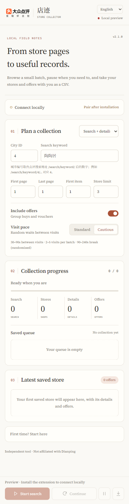
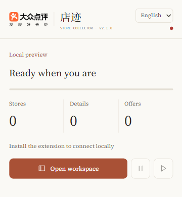

<div align="center">
  
  <h1>Dianping Store Collector · 店迹</h1>
  <p>Turn store pages you can browse into useful records, kept on your own machine.</p>
  <p><a href="README.md">简体中文</a> · <strong>English</strong></p>
  <p>v2.1.0 · Chrome / Edge · Windows · <a href="LICENSE">GPL-3.0</a></p>
</div>

Copying store names, ratings, addresses and offers into a spreadsheet gets repetitive. Store Collector visits stores in your browser, saves the details it can read, and keeps a fixed queue so you can pause and pick up where you left off.

**Try 3 stores first.** Check what was actually saved before expanding the range. This is a tool for small, supervised collections; site changes and verification prompts still need your attention.

[Get started](#get-started) · [Your first collection](#your-first-collection) · [Your results](#your-results) · [Troubleshooting](#troubleshooting)

## A look inside

A warm paper background, terracotta controls and serif typography in both languages. Switch between Chinese and English in the upper-right corner; your choice stays on this machine.

<p align="center">
  
  
</p>

These are offline interface previews, without a live collection connected. [Chinese workspace preview](docs/assets/sidepanel-preview.png).

## What you can use it for

| Your task | What the collector helps with |
| --- | --- |
| Build a shortlist of restaurants | Save search results and visit the stores in a fixed queue |
| Compare ratings, spend, tags and addresses | Put visible information into a consistent store record |
| Record group buys and vouchers | Save recognizable offer names, prices, discounts and usage notes |
| Work in several sessions | Pause, continue and recover an unfinished queue after a browser restart |
| Prepare data for review or analysis | Export CSV and retain structured records locally |

Possible uses include personal shortlists, neighborhood research and authorized exploratory studies. For research, independently check sampling coverage, collection dates and missing data. Search results are not a census of every business in an area.

Information the page does not show stays empty. Store name, address and overall rating are required to commit a store. Other fields may be missing and are reported. If an offers section is detected but cannot be parsed, the collection pauses.

## Get started

### 1. Prepare the environment

- Windows 10 / 11 and Chrome or Edge 120+
- Python 3.10+; Node.js is needed only for JavaScript tests
- **MongoDB 6.0+ already installed and running**
- A browser session in which you can access Dianping normally

The setup script installs Python dependencies. **It does not install or start MongoDB.** The default connection is `mongodb://127.0.0.1:27017`; MongoDB Compass can help you check it.

### 2. Download and start the local service

Choose **Code → Download ZIP** on this repository and extract it, preferably on D:, for example `D:\Projects\dianping-store-collector`. Or clone it:

```powershell
git clone https://github.com/cloudcollection/dianping-store-collector.git
cd dianping-store-collector
.\setup.ps1
.\start.ps1
```

To select a Python installation explicitly:

```powershell
.\setup.ps1 -PythonPath "D:\Python311\python.exe"
```

Keep the terminal open when the service is listening on `http://127.0.0.1:8765`. Paste the printed **pairing token only into your own extension**.

### 3. Load the extension

1. In Edge, open `edge://extensions`; in Chrome, open `chrome://extensions`.
2. Enable **Developer mode** and choose **Load unpacked**.
3. Select the repository's **`extension` folder**.
4. Click the Store Collector toolbar icon, then **Open workspace**.
5. Expand **Connect locally**, paste the terminal token and select **Connect**.
6. Check that the status says **MongoDB connected**.

Installation is currently from source; there is no browser-store listing. After updating, reload the extension on the extensions page and restart the local service.

## Your first collection

1. Open Dianping in the same browser. Sign in normally if required and check that a search page displays stores.
2. Select **Search + details** in the workspace. Enter a city ID and search keyword. In a Dianping search URL, the number after `/search/keyword/` is the city ID: `/search/keyword/4/…` uses `4`. Check your current city's URL.
3. Start with **first page 1, last page 1, first item 1, store limit 3**. The default pace is **Cautious**.
4. Choose whether to **Include offers**, then select **Start search**. Keep the collection tab open.
5. Watch the saved queue under **Collection progress**. The first saved store appears under **Latest saved store**, with its actual fields and offers.
6. Pause whenever needed and select **Continue** to resume. If the site requests verification or login, complete it manually on the page first.
7. Use the download button, **Export CSV**, to choose a save location. Review the first 3 stores before increasing the range.

### Modes and pacing

| Mode | Purpose |
| --- | --- |
| Search + details | Search → fixed queue → store details and optional offers |
| Search only | Save search records; the store-detail export may still be empty |
| Saved store queue | Build a detail queue from saved, pending search records |
| Current page | Manually save the active Dianping search or store page, without search-range inputs |

Pages range from 1–30; the first item ranges from 1–15. The store limit is 1–100 and cannot exceed the selected range's estimated capacity of 15 stores per page. Actual results depend on the page and may be fewer.

| Pace | Wait between actions | Visits per batch | Break between batches |
| --- | --- | --- | --- |
| Standard (快速) | 10–20 s | 3–7 | 30–90 s |
| Cautious, default | 30–90 s | 2–5 | 90–240 s |

These are randomized wait ranges, not a guarantee against access restrictions. Recognized login, verification and access-limit pages, or HTTP 401 / 403 / 406 / 429 / 503 responses, pause collection.

## Your results

### CSV for review

The filename looks like `dianping-stores-20261021-143000.csv`. It uses UTF-8 with a BOM for spreadsheet compatibility.

- **One row per store.** It exports store snapshots across the configured database, including earlier tasks, rather than only the active queue.
- There are 12 fixed columns, listed below.
- Lists such as tags, recommended dishes and offers are **JSON text inside cells**. Offers are not exported one per row.
- An empty database still produces column headers. Search-only collection does not create store-detail rows.
- Both interface languages retain the same Chinese data keys for compatibility.
- Download tickets are single-use and expire after 60 seconds. Values that could be interpreted as spreadsheet formulas are written as text.

| CSV field | Meaning |
| --- | --- |
| 店铺id | Store ID |
| 店铺名 | Store name |
| 评论总数 | Review count |
| 人均价格 | Average spend |
| 标签 | Tags |
| 店铺地址 | Address |
| 店铺均分 | Rating details |
| 推荐菜 | Recommended dishes |
| 店铺总分 | Overall rating |
| 优惠券信息 | Offers |
| 最后采集时间 | Last collected |
| 首次采集时间 | First collected |

See the [fictional store example](examples/store.example.json). To analyze individual offers, use MongoDB's `deals` collection or expand the offer JSON in the CSV.

### Records on your machine

The default MongoDB database is `dianping_collector`:

| Collection | Contents |
| --- | --- |
| `shops` | Latest snapshot for each store |
| `search_results` | Search records, task scope and queue order |
| `deals` | Structured group buys and vouchers |
| `shop_commits` | Completed-store records for recovery and skipping committed stores |
| `network_captures` | Response-evidence metadata and local file paths |

The project's `data/` directory also holds local records, the pairing token and response evidence. Evidence defaults to a 250 MB limit and a 14-day retention period. Browser-local storage holds task state, language, settings and pairing information. **A CSV export is not a task backup:** copying it to another computer does not recover the original queue.

Set configuration before starting the service:

```powershell
$env:DIANPING_MONGO_URI = "mongodb://127.0.0.1:27017"
$env:DIANPING_MONGO_DATABASE = "dianping_collector"
$env:DIANPING_DATA_DIR = "D:\DianpingData"
.\start.ps1
```

See [configuration](docs/CONFIGURATION.md) for additional settings.

## Troubleshooting

| Symptom | Check |
| --- | --- |
| Local service offline | Keep the `start.ps1` terminal open; check whether port 8765 is already in use |
| MongoDB disconnected | Start MongoDB and verify its connection address |
| Pairing failed | Use the token from the current local service, without surrounding whitespace |
| Python setup fails | Select Python 3.10+ with `-PythonPath` and read the installation error |
| PowerShell blocks a script | Check its source and your device policy; if appropriate, use `Unblock-File` on the trusted downloaded scripts |
| Offers are empty or collection pauses | The page may have no offers, may need to expand a section, or may have changed; inspect the error and page |
| A store never completes | Missing required fields, offer parsing failures and storage failures keep the queue on that store |
| Some stores are skipped after continuing | Stores with valid completion records are skipped |
| Can I close the toolbar popup? | Yes. Keep the browser, collection tab and local service running |
| CSV contains only headers | No store details have been committed in the configured database yet |

## Data and permissions

Records go to your configured MongoDB and local directory; the project has no hosted data-receiving service. Permissions such as `tabs` and `scripting` support page navigation. The `debugger` permission listens to relevant page responses and may trigger a browser debugging notice. A pairing token protects the local API, which binds to the loopback address by default.

Do not publish `data/`, database backups, pairing tokens or logs with account details. There is no CAPTCHA bypass, cookie export, proxy rotation or concurrent request flooding. Collect only data you are allowed to access and use.

## Development and limitations

```powershell
.\test.ps1
```

Python tests cover the API, pairing, parsing, storage and export. JavaScript tests cover queue recovery, randomized pacing, content-script reinjection, language and progress. Tests use local fixtures and simulated interfaces. **This release has not completed broad live-site compatibility testing.** Passing offline tests does not establish compatibility with every city or page.

- Dianping changes may require parser and selector updates.
- Setup and launch scripts target Windows PowerShell.
- Missing data is not zero; displayed ratings are not independently verified facts.
- Typography prefers locally installed Claude font names and bundles Source Serif 4 plus a Noto Serif SC interface subset. These reproduce the requested style without redistributing commercial Claude fonts. See [asset provenance](docs/ASSETS.md).
- [Design references and review notes](docs/DESIGN_REVIEW.md) explain the adopted recommendations and revisions.

```text
backend/      Local service, parsing and storage
extension/    Manifest V3 extension and local fonts
tests/        Regression tests
docs/         Configuration, design references and screenshots
examples/     Clearly fictional output example
tools/        Reproducible font-subset builder
```

When reporting a bug, include reproduction steps, browser/version, task mode and a redacted error message. Small, verifiable contributions are welcome.

## Credits and license

This project modifies GPL-3.0 code from [Sniper970119/dianping_spider](https://github.com/Sniper970119/dianping_spider), adding a browser-extension workflow, local service, task recovery, interface and tests.

Code is licensed under [GNU GPL v3.0](LICENSE). Bundled fonts retain their SIL Open Font Licenses. The Dianping mark identifies the supported platform and belongs to its owner. This project is not affiliated with or endorsed by Dianping, Meituan or Anthropic.
