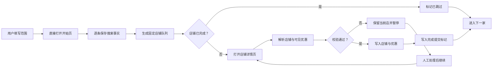

<div align="center">
  
  <h1>店迹 · Dianping Store Collector</h1>
  <p><strong>把你正在使用的浏览器，变成一个可恢复、可追溯、本地优先的店铺采集工作台。</strong></p>
  <p>
    搜索结果、店铺详情、团购套餐与代金券，一条固定队列顺序完成。<br>
    不导出 Cookie，不绕过验证码，不把业务数据上传到第三方服务。
  </p>

  <p>
    
    
    
    
    <a href="LICENSE"></a>
  </p>

  <p>
    <a href="#-三分钟上手"><strong>快速开始</strong></a>
    ·
    <a href="#-它能做什么"><strong>功能</strong></a>
    ·
    <a href="#-安全与隐私"><strong>安全</strong></a>
    ·
    <a href="#-路线图"><strong>路线图</strong></a>
  </p>
</div>

---

## 为什么做「店迹」

大众点评数据采集最难的部分，往往不是写出第一个选择器，而是让一个真实任务能够：

- 在用户已经登录、正常可访问的浏览器里工作；
- 从指定页和指定序号开始，不必每次从第一页重来；
- 浏览器重启、人工暂停或页面验证后，仍从原固定队列继续；
- 区分“页面确实没有数据”和“解析器失效”，避免静默写入错误结果；
- 让数据留在自己的 MongoDB，而不是交给未知的云端采集服务。

传统一次性脚本通常只解决“抓到一页”。店迹更关心的是：**一个小批量任务能否安全地跑完、停得住、接得上、查得清。**

## ✨ 效果预览

<div align="center">
  
  &nbsp;&nbsp;
  
</div>

侧边栏负责完整任务控制；工具栏弹窗只保留状态、暂停、继续和打开控制台。所有操作都围绕固定队列和恢复流程设计。

## 🚀 三分钟上手

### 1. 准备环境

需要：

- Windows 10/11
- Edge 或 Chrome 120+
- Python 3.10+
- MongoDB 6.0+

MongoDB 默认连接地址：

```text
mongodb://127.0.0.1:27017
```

如需修改，可在启动前设置 `DIANPING_MONGO_URI`。

### 2. 安装并启动本地服务

在 PowerShell 中进入项目目录：

```powershell
.\setup.ps1
.\start.ps1
```

启动时终端会显示一枚本机配对令牌。它只用于你的浏览器扩展访问 `127.0.0.1:8765`，不要分享或提交到仓库。

### 3. 加载浏览器扩展

1. 在 Edge 打开 `edge://extensions`。
2. 启用“开发人员模式”。
3. 点击“加载解压缩的扩展”。
4. 选择项目中的 `extension` 目录。
5. 打开“店迹”侧边栏，把终端令牌粘贴到“本地服务配对”。

完成配对后，状态会显示“MongoDB 在线”，即可创建任务。

> Chrome 用户可在 `chrome://extensions` 使用同样步骤。

## 🎯 它能做什么

| 能力 | 说明 |
|---|---|
| 指定范围搜索 | 城市、关键词、开始页、截至页、页内起点和采集数量 |
| 固定任务队列 | 记录稳定店铺 ID 与全局序号，恢复时不重新排序 |
| 店铺详情 | 店名、评分、地址、人均、标签、推荐菜等可见字段 |
| 优惠信息 | 同页采集团购套餐与代金券，不额外打开购买详情页 |
| 断点续采 | 暂停、浏览器重启或验证处理后继续当前店铺 |
| 自动跳过 | 已提交完成的店铺不会再次打开详情页 |
| 限制即停 | 登录、滑块、验证码、限流和解析异常会停止导航 |
| 本地存储 | MongoDB 主存储，本地写入镜像用于故障重放 |
| 安全导出 | 一次性下载凭证，CSV 文本防公式注入 |
| 原始证据 | 仅保留相关网络响应，并受大小、容量和保留期限制 |

## 一次任务如何运行



只有店铺主记录、优惠兼容明细和完成提交标记都成功后，队列项才会被视为完成。

## 📦 数据结构

默认数据库为 `dianping_collector`：

| 集合 | 用途 |
|---|---|
| `shops` | 每家店一条当前快照 |
| `search_results` | 每次任务中的搜索事实与固定序号 |
| `deals` | 团购套餐和代金券兼容明细 |
| `shop_commits` | 可恢复的完成提交状态 |
| `network_captures` | 原始证据索引，不在 MongoDB 重复保存完整正文 |

`shops` 对外保持 12 个字段：

```text
店铺id、店铺名、评论总数、人均价格、标签、店铺地址、
店铺均分、推荐菜、店铺总分、优惠券信息、最后采集时间、首次采集时间
```

店铺名、地址和总分是身份校验字段。人均价格、标签、推荐菜等在页面合法缺失时允许为空，并会返回完整性提示，不会把整个队列永久卡住。

## 🔐 安全与隐私

店迹 2.0 默认把本地服务视为安全边界：

- 所有业务 API 需要随机配对令牌；
- CORS 仅允许浏览器扩展来源；
- 导出使用 60 秒、一次性的下载凭证；
- 请求正文、网络证据正文、原始文件总量和保留时间均有限制；
- 配对令牌、数据、日志、CSV、虚拟环境和浏览器配置都被 `.gitignore` 排除；
- 没有遥测、云端账号或第三方数据上传。

更完整的说明见 [PRIVACY.md](PRIVACY.md) 与 [SECURITY.md](SECURITY.md)。

## 🧭 访问策略与边界

这个项目坚持“失败即停”，而不是“失败后更激进地重试”：

- 快速档：动作间隔 10–20 秒，每批 3–7 次，批次休息 30–90 秒；
- 稳妥档：动作间隔 30–90 秒，每批 2–5 次，批次休息 90–240 秒；
- 所有范围使用浏览器安全随机源重新抽取；
- HTTP 401、403、406、429、503，登录页、滑块、验证码或典型限制文本都会暂停。

本项目不提供验证码绕过、Cookie 导出、代理池轮换、自动化隐藏或并发轰炸，也不承诺账号/IP 永不受限。请只处理你有权访问和使用的数据，并遵守网站条款及适用法律。

## 🧪 测试

```powershell
.\test.ps1
```

当前测试覆盖：

- 后端 API 鉴权与一次性导出；
- 搜索、详情、优惠与提交状态；
- 合法缺失字段；
- CSV 公式注入防护；
- 优惠标准化与稳定唯一键；
- 固定队列和浏览器重启恢复；
- 随机访问节奏；
- 内容脚本重复注入；
- 侧边栏与弹窗窄宽度布局。

真实网站会变化，因此自动化测试使用固定页面/响应样本；真实页面只进行人工、低频、小样本验收。

## 🧱 项目结构

```text
dianping-store-collector/
├─ backend/            # FastAPI、本地鉴权、MongoDB 与解析逻辑
├─ extension/          # Manifest V3 浏览器扩展
├─ tests/              # Python 与原生 JavaScript 回归测试
├─ docs/               # RPD、架构说明和界面预览
├─ setup.ps1           # 创建本地 Python 环境
├─ start.ps1           # 显示配对令牌并启动服务
└─ test.ps1            # 一键运行测试
```

架构与故障恢复细节见 [docs/ARCHITECTURE.md](docs/ARCHITECTURE.md)。

## 🗺️ 路线图

- [x] Manifest V3 侧边栏控制台
- [x] 搜索事实与固定队列
- [x] 店铺详情、团购套餐和代金券
- [x] 暂停、恢复和自动跳过已完成店铺
- [x] 本地 API 配对鉴权
- [x] MongoDB 重连与本地写入重放
- [x] 安全 CSV 导出
- [x] 原始证据容量与保留策略
- [ ] 更多页面版式 fixture
- [ ] macOS/Linux 启动脚本
- [ ] 可选择的 JSONL 导出
- [ ] 浏览器商店安装包

## 常见问题

<details>
<summary><strong>为什么必须使用 MongoDB？</strong></summary>

固定队列、店铺快照、优惠明细和完成提交需要可查询、可幂等更新的主存储。本地 JSON 是故障重放镜像，不作为长期主查询入口。
</details>

<details>
<summary><strong>MongoDB 后启动怎么办？</strong></summary>

本地服务会按退避间隔自动重连。MongoDB 恢复后无需重新安装扩展；等待状态变为在线，再继续原任务即可。
</details>

<details>
<summary><strong>为什么页面没有人均价格也能保存？</strong></summary>

这可能是合法缺失，不一定是解析失败。2.0 只把稳定身份字段作为阻断条件，其余字段会记录为缺失提示。
</details>

<details>
<summary><strong>为什么检测到优惠栏目但没有优惠时会暂停？</strong></summary>

“页面没有优惠栏目”和“页面有栏目但解析器失效”是两种不同情况。后者如果静默写入空数组，会造成难以发现的数据错误。
</details>

## 🤝 参与贡献

如果这个项目解决了你的真实问题：

- 用一个 Star 让更多人发现它；
- 提交脱敏后的页面版式问题；
- 为新的固定 fixture、解析器或文档发起 PR；
- 在 Issue 中描述版本、步骤、预期结果和实际结果。

请先阅读 [CONTRIBUTING.md](CONTRIBUTING.md)。安全问题不要公开披露，请遵循 [SECURITY.md](SECURITY.md)。

## 致谢与许可

本项目基于 [Sniper970119/dianping_spider](https://github.com/Sniper970119/dianping_spider) 的 GPL-3.0 代码演进，并对浏览器工作流、存储模型、安全边界和界面进行了重构。详细说明见 [NOTICE.md](NOTICE.md)。

项目使用 [GNU General Public License v3.0](LICENSE)。如果未来公开分发修改版本，请继续遵守 GPL-3.0 的源代码与许可要求。

---

<div align="center">
  <strong>店迹不是“更激进的爬虫”，而是一个更诚实、更可恢复的浏览器采集工作台。</strong>
</div>
