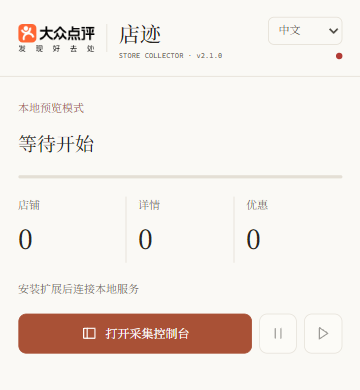

<div align="center">
  
  <h1>店迹 · Dianping Store Collector</h1>
  <p>把你能正常浏览的店铺与优惠，整理成留在本机的数据。</p>
  <p><strong>简体中文</strong> · <a href="README.en.md">English</a></p>
  <p>v2.1.0 · Chrome / Edge · Windows · <a href="LICENSE">GPL-3.0</a></p>
</div>

找店、抄地址、记评分，再把团购和代金券挨个复制到表格里——这些重复工作可以少做一些。店迹在你自己的浏览器中按顺序访问店铺，保存资料和优惠；中途暂停后，可以接着上次的队列继续。

**先从 3 家店试起。** 看过实际保存的字段，再决定是否扩大范围。它适合有人看着的小批量整理；页面改版或要求验证时，仍需要你处理。

[快速上手](#快速上手) · [第一次采集](#第一次采集) · [结果在哪里](#结果在哪里) · [常见问题](#常见问题)

## 看看界面

暖白背景、陶土色按钮，中英文衬线排版。右上角可以切换中文与 English，设置保存在本机。

<p align="center">
  
  
</p>

以上为离线界面预览，未接入真实采集任务。[英文界面](docs/assets/sidepanel-preview-en.png)也可预览。

## 能帮你做什么

| 你想做的事 | 店迹提供的帮助 |
| --- | --- |
| 整理一批候选餐厅 | 保存搜索结果，按固定队列补齐店铺资料 |
| 比较评分、人均、标签和地址 | 将页面显示的信息放入统一的店铺记录 |
| 记录团购和代金券 | 保存页面可识别的名称、价格、折扣、使用说明等 |
| 分几次完成同一批整理 | 暂停、继续，重新打开浏览器后恢复未完成队列 |
| 准备后续分析或人工核对 | 导出 CSV；结构化记录与恢复信息保存在本机 |

例如，可以用于消费清单、商圈资料整理，或经过授权的探索性研究。研究使用时，需要另行核验样本覆盖、采集日期和缺失值；搜索结果并不等于某个区域的全部商户。

页面上没有展示的信息会留空。店名、地址和总分属于必要字段；缺少这些字段时，当前店铺不会提交为完成。其他字段允许缺失，并会提示。优惠栏目存在但解析失败时，任务也会暂停。

## 快速上手

### 1. 准备环境

- Windows 10 / 11，Chrome 或 Edge 120+
- Python 3.10+；Node.js 只在运行 JavaScript 测试时需要
- **已经安装并启动的 MongoDB 6.0+**
- 你可以正常访问的大众点评浏览器会话

安装脚本会安装 Python 依赖，**不会安装或启动 MongoDB**。MongoDB 的默认地址为 `mongodb://127.0.0.1:27017`；可用 MongoDB Compass 检查连接。

### 2. 下载并启动本地服务

从本仓库 **Code → Download ZIP** 下载并解压，建议放到 D 盘，例如 `D:\Projects\dianping-store-collector`。也可以：

```powershell
git clone https://github.com/cloudcollection/dianping-store-collector.git
cd dianping-store-collector
.\setup.ps1
.\start.ps1
```

找不到正确的 Python 时，显式指定解释器：

```powershell
.\setup.ps1 -PythonPath "D:\Python311\python.exe"
```

看到服务监听 `http://127.0.0.1:8765` 后，保持终端打开。启动时显示的**配对令牌只粘贴到自己的扩展**。

### 3. 加载浏览器扩展

1. Edge 打开 `edge://extensions`；Chrome 打开 `chrome://extensions`。
2. 打开**开发者模式**，选择**加载解压缩的扩展**。
3. 选择仓库中的 **`extension` 文件夹**。
4. 点击工具栏的店迹图标，再点击**打开采集控制台**。
5. 展开**本地服务配对**，粘贴终端令牌，点击**保存并连接**。
6. 确认界面显示 **MongoDB 在线**。

目前通过源码安装，尚无浏览器商店安装链接。更新后需要在扩展管理页点击**重新加载**，并重启本地服务。

## 第一次采集

1. 在同一浏览器打开大众点评，完成你正常需要的登录，确认搜索页能显示店铺。
2. 在控制台选择**完整流程**，填写城市编号和店铺关键词。城市编号可从点评搜索地址中 `/search/keyword/` 后面的数字读取，例如 `/search/keyword/4/…` 对应 `4`；请以你当前页面的城市为准。
3. 先设**开始页 1、截至页 1、页内起点 1、采集数量 3**。默认采用**稳妥**节奏。
4. 按需打开**采集优惠**，点击**开始搜索**，保持采集标签页打开。
5. 在**任务进度**中查看固定队列。完成首家店后，**最新完成**会显示实际保存的字段和优惠。
6. 需要停下时点击暂停；恢复时点击**继续上次**。遇到登录或验证，先在页面人工处理，再继续。
7. 点击底部下载图标**安全导出 CSV**，选择文件保存位置。先核对 3 家结果，再扩大范围。

### 任务模式与访问节奏

| 模式 | 用途 |
| --- | --- |
| 完整流程 | 搜索 → 建立队列 → 店铺详情与可选优惠 |
| 仅搜索 | 只保存搜索记录；此时店铺详情导出可能仍为空 |
| 仅店铺页 | 从已保存的待处理搜索记录建立详情队列 |
| 当前页 | 手动保存当前大众点评搜索页或店铺页，不使用搜索范围输入 |

开始页与截至页范围为 1–30；页内起点为 1–15，数量为 1–100，且不得超过所选范围按每页 15 家估算的容量。实际可用结果以页面为准，可能少于上限。

| 节奏 | 每次等待 | 每批访问数 | 批间休息 |
| --- | --- | --- | --- |
| 快速 | 10–20 秒 | 3–7 次 | 30–90 秒 |
| 稳妥（默认） | 30–90 秒 | 2–5 次 | 90–240 秒 |

这些值是随机等待范围，不是避免限流的保证。扩展识别到登录、验证或访问限制，或收到 401 / 403 / 406 / 429 / 503 响应时，会暂停采集。

## 结果在哪里

### 给你查看的 CSV

文件名类似 `dianping-stores-20261021-143000.csv`，UTF-8 编码，带 BOM，可用 Excel 打开。

- **一行一家店**，导出的是当前配置数据库中的店铺快照，包含历史任务，不仅是当前队列。
- 固定 12 列：店铺id、店铺名、评论总数、人均价格、标签、店铺地址、店铺均分、推荐菜、店铺总分、优惠券信息、最后采集时间、首次采集时间。
- 标签、推荐菜、优惠券信息等列表以 **JSON 文本**写进单元格；优惠并非一行一条。
- 没有已保存店铺时，CSV 仍包含表头。仅搜索不会自动产生店铺详情行。
- 中英文界面使用同一套中文数据字段，便于兼容已有数据。
- 导出凭证一次有效，60 秒后过期；可能被表格软件当成公式的单元格会作为文本处理。

参见[虚构的单店记录示例](examples/store.example.json)。若要逐条分析优惠，可读取 MongoDB 的 `deals` 集合，或展开 CSV 中的优惠 JSON。

### 本地保存的记录

默认 MongoDB 数据库为 `dianping_collector`：

| 集合 | 保存内容 |
| --- | --- |
| `shops` | 每家店的最新资料快照 |
| `search_results` | 搜索记录、任务范围与固定队列顺序 |
| `deals` | 结构化团购与代金券 |
| `shop_commits` | 完成记录，用于恢复与跳过已提交店铺 |
| `network_captures` | 相关响应证据的元数据与本地文件路径 |

项目的 `data/` 目录还会保存本地记录、配对令牌和响应证据。响应证据默认最多 250 MB，保留 14 天。浏览器本机存储保存任务状态、界面语言、设置和配对信息。**导出 CSV 不等于备份任务**；换电脑时不能只复制 CSV 就期待继续原队列。

相关配置可在启动服务前设置：

```powershell
$env:DIANPING_MONGO_URI = "mongodb://127.0.0.1:27017"
$env:DIANPING_MONGO_DATABASE = "dianping_collector"
$env:DIANPING_DATA_DIR = "D:\DianpingData"
.\start.ps1
```

更多配置见[配置说明](docs/CONFIGURATION.md)。

## 常见问题

| 现象 | 先检查这里 |
| --- | --- |
| 本地服务离线 | `start.ps1` 的终端是否仍开着，8765 端口是否被占用 |
| MongoDB 未连接 | MongoDB 是否启动，连接地址是否正确 |
| 配对失败 | 复制当前服务显示的令牌，别带前后空格；不要复制别人的令牌 |
| Python 安装失败 | 用 `-PythonPath` 指定 3.10+，检查终端中的具体安装错误 |
| PowerShell 提示脚本受阻 | 查看脚本来源和系统策略；必要时在确认来源后对下载的脚本使用 `Unblock-File`，遵守单位设备策略 |
| 优惠为空或任务暂停 | 页面可能无优惠、尚未展开，或网站结构已经变化；查看错误信息并人工核对 |
| 当前店铺始终没完成 | 必要字段或优惠解析失败、存储失败都会留在当前店铺，避免静默跳过 |
| 继续后部分店铺显示“已跳过” | 已存在完整完成记录；已提交店铺会被跳过 |
| 弹窗关闭后还能否采集 | 可关闭工具栏弹窗；保持浏览器、采集标签页和本地服务运行 |
| CSV 只有表头 | 可能尚未完成详情采集，或当前数据库没有店铺记录 |

## 数据与权限

数据写入你配置的 MongoDB 与本地目录，项目没有托管的数据接收服务。扩展需要 `tabs`、`scripting` 等权限完成页面访问；`debugger` 用于监听相关页面响应，浏览器可能显示调试提示。配对令牌限制本地 API 访问，服务默认仅监听回环地址。

不要上传 `data/`、数据库备份、配对令牌或带账号内容的日志。项目不包含验证码绕过、Cookie 导出、代理轮换或并发请求轰炸功能。请仅整理你获准访问和使用的数据。

## 开发与已知限制

```powershell
.\test.ps1
```

Python 测试覆盖接口、配对、解析、存储和导出；JavaScript 测试覆盖队列恢复、随机节奏、页面脚本重复注入、语言与进度。测试使用本地样本和模拟接口；**本版尚未完成广泛的真实网站兼容性验证**，不要把通过离线测试理解为所有城市和页面均可采集。

- 网站会变化，解析器和页面选择器可能需要更新。
- 安装与启动脚本以 Windows PowerShell 为目标。
- 缺少数据不代表零；页面评分也不是独立核实后的事实。
- 英文字体优先匹配本机 Claude 同名字体，并附带 Source Serif 4；中文界面附带 Noto Serif SC 子集。它们用于呈现 Claude 风格，**不是重新分发 Claude 商业字体**。[素材来源](docs/ASSETS.md)
- [本次设计、文档参考与自审记录](docs/DESIGN_REVIEW.md)记录了采用的建议与修订。

```text
backend/      本地服务、解析与存储
extension/    Manifest V3 扩展与本地字体
tests/        回归测试
docs/         配置、设计参考与截图
examples/     明确标为虚构的结果示例
tools/        字体子集的复现工具
```

提交问题时，请给出复现步骤、浏览器和版本、任务模式，以及脱敏后的错误信息。欢迎小范围、可验证的改进。

## 致谢与许可

本项目基于 [Sniper970119/dianping_spider](https://github.com/Sniper970119/dianping_spider) 的 GPL-3.0 代码改写，新增了浏览器扩展工作流、本地服务、任务恢复、界面及测试。

代码使用 [GNU GPL v3.0](LICENSE)。随附字体使用各自的 SIL Open Font License。大众点评标志用于说明适配的平台，相关商标归权利人所有；本项目与大众点评、美团及 Anthropic 均无隶属或背书关系。
